# lmcell

Agent-based cell biology in one command: tumours that starve, wounds that close, drugs that fail to penetrate, cells that follow gradients. PhysiCell and BioFVM compute; lmplot, lmdraw and lmblender draw.

[](https://github.com/lmctl-ai/lmcell/actions/workflows/ci.yml)
[](https://github.com/lmctl-ai/lmcell/releases)
[](LICENSE)

### Tumours and therapy

| Starving tumour: dead core, live rim | The same tumour, path-traced | Drugs stop a few cell layers from the vessel |
| --- | --- | --- |
| 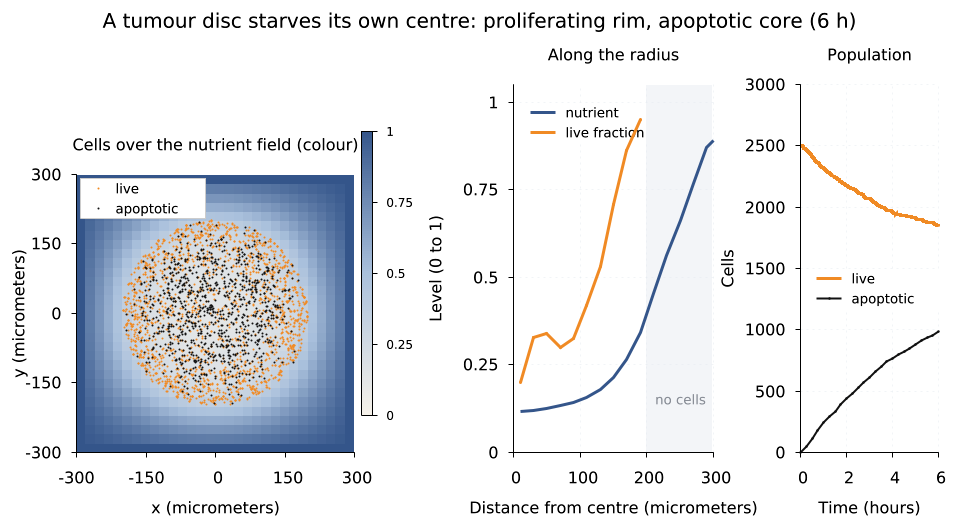 | 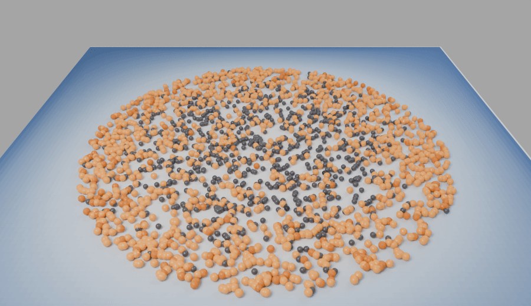 | 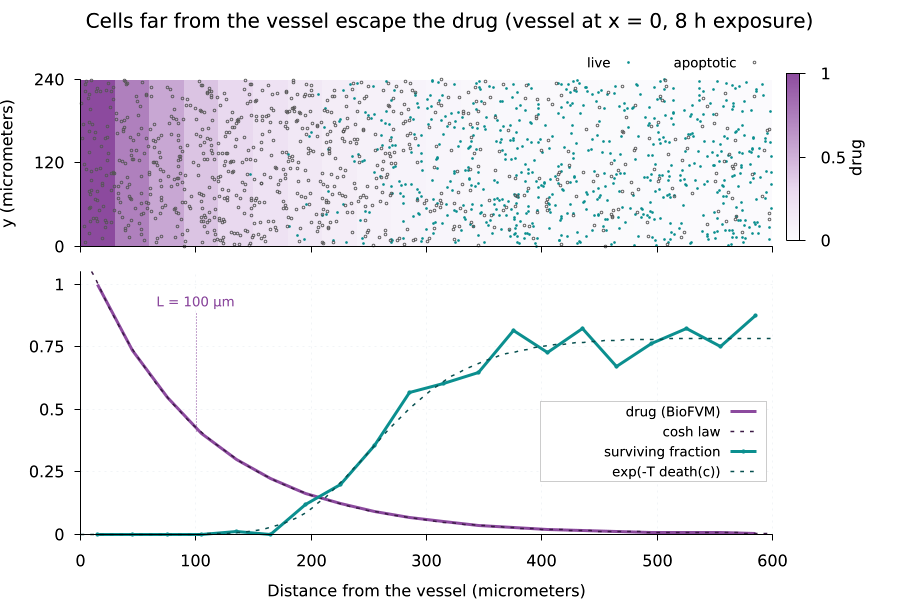 |
| Uptake outruns diffusion: the centre falls to 0.1 nutrient and dies, a ~60 µm rim keeps dividing ([animation](docs/images/spheroid_necrosis.gif))<br>`lmctl autorun https://raw.githubusercontent.com/lmctl-ai/lmcell/main/examples/spheroid_necrosis.lms` | lmcell → lmplot ground texture → lmblender Cycles: every cell as a sphere, the dead core sits on the palest ground<br>`lmctl autorun https://raw.githubusercontent.com/lmctl-ai/lmcell/main/examples/tumour_render.lms` | Drug falls as cosh with L = √(D/k) = 100 µm; survival follows exp(−T·death(c)) to within noise ([animation](docs/images/drug_penetration.gif))<br>`lmctl autorun https://raw.githubusercontent.com/lmctl-ai/lmcell/main/examples/drug_penetration.lms` |

| Therapy selects resistance |
| --- |
| 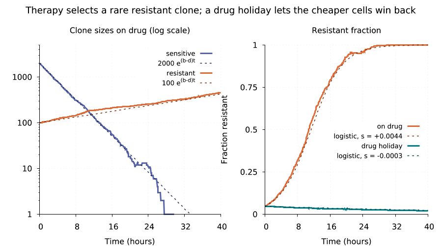 |
| Each clone grows as e^{(b−d)t}; the resistant fraction follows the logistic law, s = +0.0044/min on drug, −0.0003 on holiday<br>`lmctl autorun https://raw.githubusercontent.com/lmctl-ai/lmcell/main/examples/drug_resistance.lms` |

### Tissue and migration

| Scratch-wound assay | Contact inhibition sets carrying capacity | Chemotaxis: steering bias sets drift |
| --- | --- | --- |
| 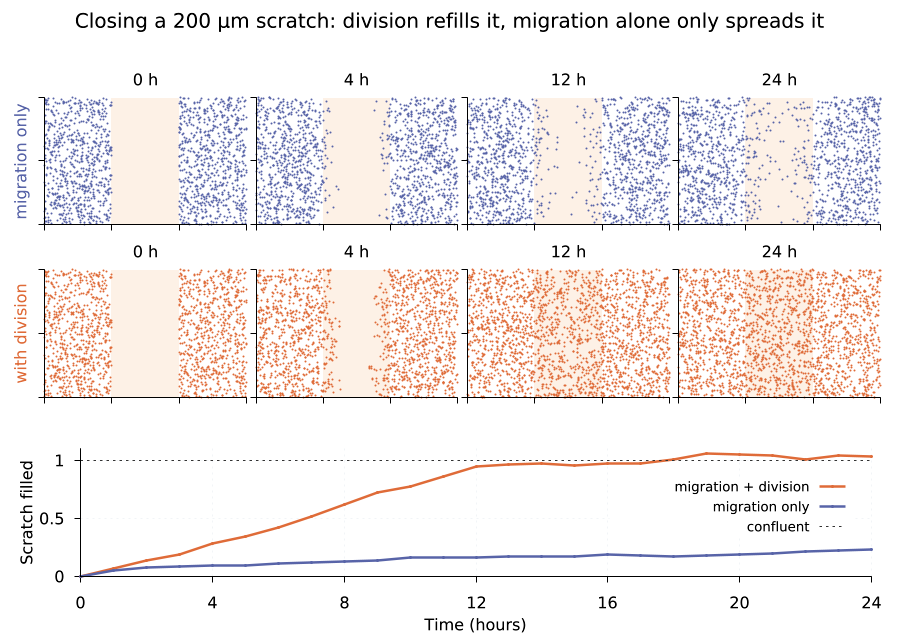 | 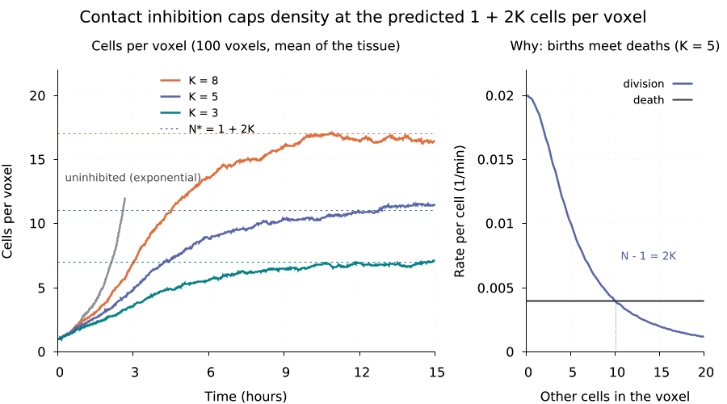 | 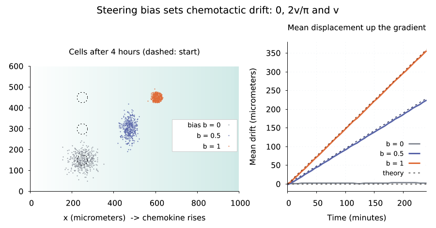 |
| Division refills the scratch in ~12 h; migration alone fills only ~20 % ([animation](docs/images/wound_closure.gif))<br>`lmctl autorun https://raw.githubusercontent.com/lmctl-ai/lmcell/main/examples/wound_closure.lms` | Crowding rule on the built-in `neighbors` signal: plateaus land on N* = 1 + K√(r/d − 1) = 7, 11, 17<br>`lmctl autorun https://raw.githubusercontent.com/lmctl-ai/lmcell/main/examples/contact_inhibition.lms` | Linear gradient between fixed edges; drift is 0, 2v/π and v for bias 0, ½, 1 ([animation](docs/images/chemotaxis_drift.gif))<br>`lmctl autorun https://raw.githubusercontent.com/lmctl-ai/lmcell/main/examples/chemotaxis_drift.lms` |

### Rules and signals

| Three Hill rule forms, measured | Oxygen feedback halves apoptosis | Secreted signal saturates with load |
| --- | --- | --- |
| 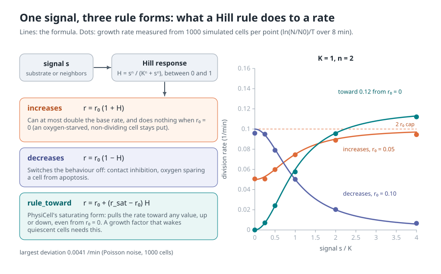 | 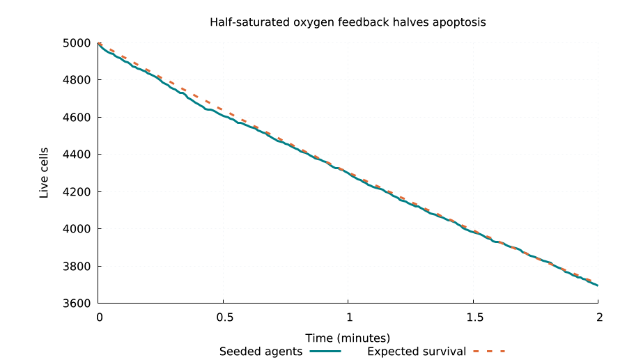 | 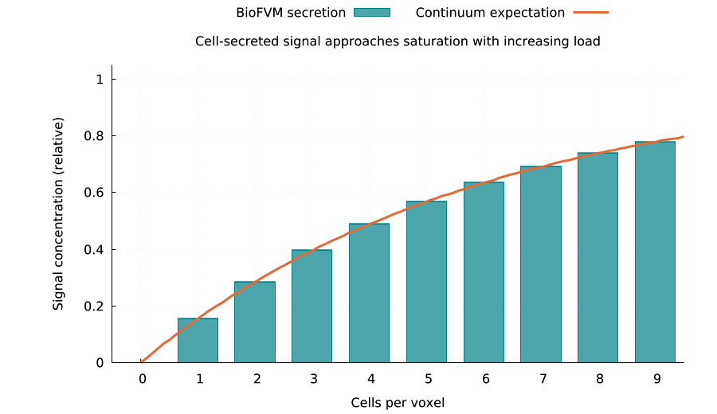 |
| `increases` caps at 2×, `decreases` switches off, `rule_toward` reaches any rate, even from 0; 18 populations in one run<br>`lmctl autorun https://raw.githubusercontent.com/lmctl-ai/lmcell/main/examples/hill_rules.lms` | A decreasing rule at half-max halves the death rate: survival 5000·e^{−0.15t}<br>`lmctl autorun https://raw.githubusercontent.com/lmctl-ai/lmcell/main/examples/oxygen_rules.lms` | Volume-weighted secretion relaxes each voxel toward S/(S+U)<br>`lmctl autorun https://raw.githubusercontent.com/lmctl-ai/lmcell/main/examples/secretion_signal.lms` |

### Checked against closed forms

| Division: exponential growth | Apoptosis: exponential survival | Persistent random walk |
| --- | --- | --- |
| 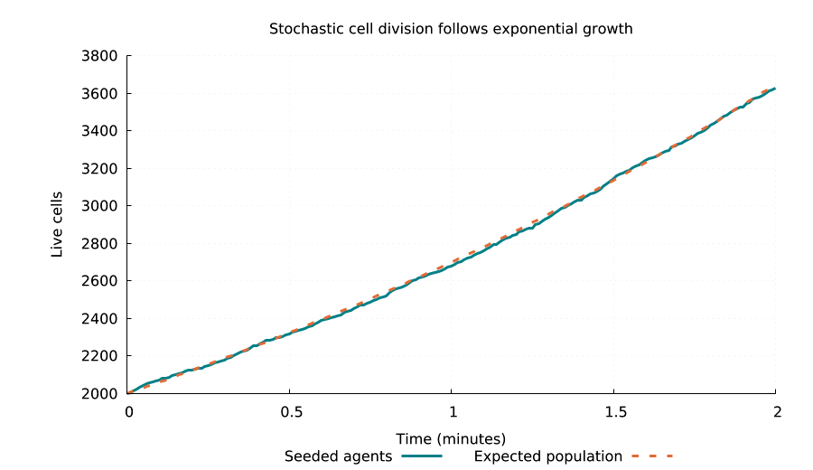 | 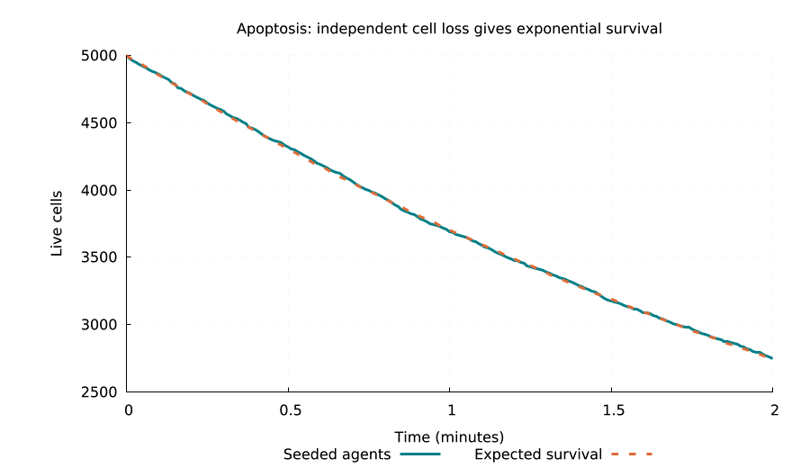 | 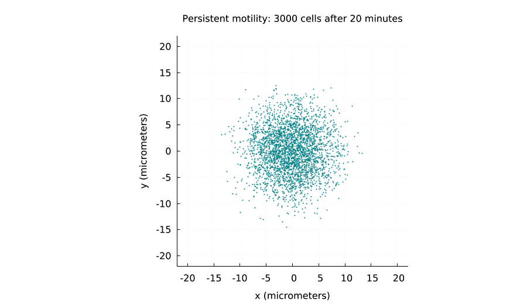 |
| One-phase live cycle at 0.3/min matches N₀e^{rt}<br>`lmctl autorun https://raw.githubusercontent.com/lmctl-ai/lmcell/main/examples/growth_birth.lms` | Independent death at 0.3/min gives N₀e^{−dt}<br>`lmctl autorun https://raw.githubusercontent.com/lmctl-ai/lmcell/main/examples/apoptosis_loss.lms` | 3000 walkers from one seed spread isotropically; the MSD follows the persistent-walk law<br>`lmctl autorun https://raw.githubusercontent.com/lmctl-ai/lmcell/main/examples/persistent_swarm.lms` |

| Penetration length | Uptake scales with load | Well-mixed decay |
| --- | --- | --- |
| 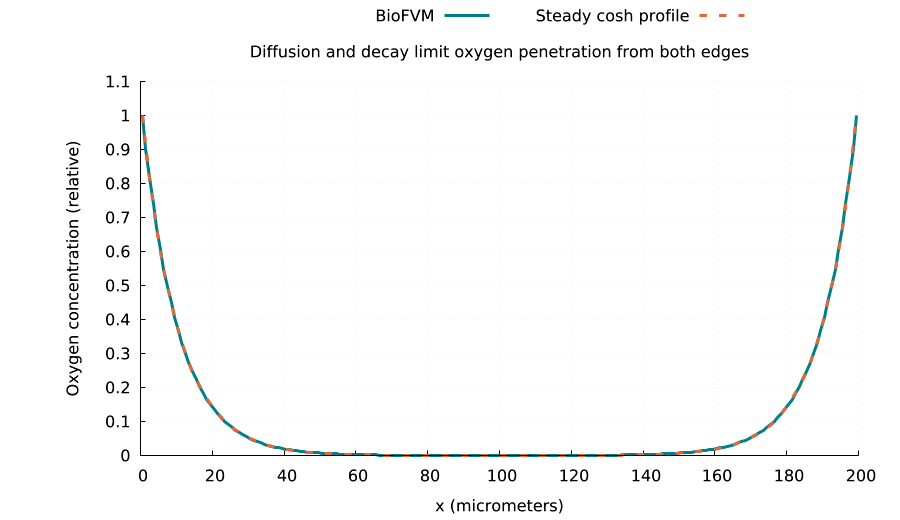 | 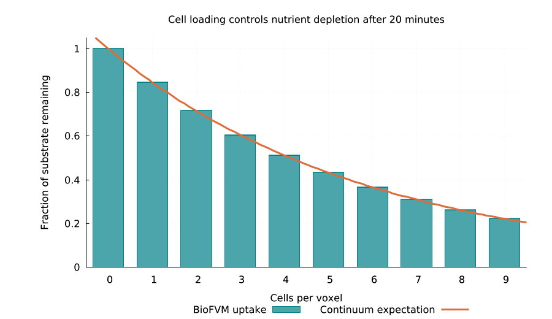 | 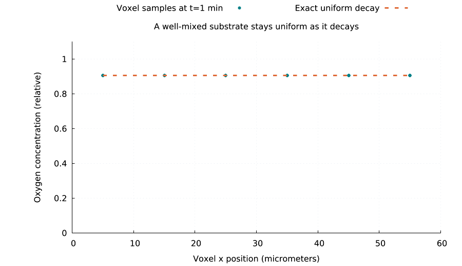 |
| Diffusion with decay between fixed edges reproduces the cosh profile<br>`lmctl autorun https://raw.githubusercontent.com/lmctl-ai/lmcell/main/examples/oxygen_penetration.lms` | More cells per voxel deplete a substrate as the continuum law predicts<br>`lmctl autorun https://raw.githubusercontent.com/lmctl-ai/lmcell/main/examples/uptake_load.lms` | A uniform field decays as e^{−λt} in every voxel, with no spurious gradients<br>`lmctl autorun https://raw.githubusercontent.com/lmctl-ai/lmcell/main/examples/tissue_decay.lms` |

Every picture is produced by the example under it; [examples/render-all.sh](examples/render-all.sh) regenerates them all.

## Quick start (1 minute)

```sh
npm install -g @lmctl-ai/lmctl
mkdir try-lmcell && cd try-lmcell
lmctl autorun https://raw.githubusercontent.com/lmctl-ai/lmcell/main/examples/contact_inhibition.lms
```

The first run downloads the lmcell and lmplot release binaries for your platform (Linux binaries require dynamic glibc >= 2.35, Ubuntu 22.04+); the example checks its numbers against the formula and writes `images/contact_inhibition.png`. Every command above works the same way from an empty folder. Examples that animate also write `images/<name>.gif` when `ffmpeg` is on your PATH; `tumour_render` additionally downloads lmblender.

## Write your own

```lmscript
p = _dsl_ cli="lmcell" install="github:lmctl-ai/lmcell@latest";
let s = cell.sim(7).domain(-200.0, 200.0, -200.0, 200.0, 20.0);
s.substrate("oxygen", 2000.0, 0.0, 1.0, 1.0);            # edges held at 1
let t = s.cell_type("tumour").radius(8.0).exchange("oxygen", 0.5, 0.0);
t.rule_toward("oxygen", "cycle entry", 0.002, 0.4, 2.0);  # divide when fed
t.rule_toward("oxygen", "apoptosis", 0.0, 0.15, 4.0).death(0.004); # die when starved
let r = s.seed_disk("tumour", 1000, 0.0, 0.0, 120.0).record(30.0).run(360.0, 0.1);
r.cells().save_csv("cells.csv");          # x, y, type, alive
r.history().save_csv("history.csv");      # time, x, y, type, alive every 30 min
r.profiles().save_csv("oxygen.csv");      # x, y, oxygen
end _dsl_
savedsl(p, "tissue.dslb");
system ${dsl_cli(p)} --dsl tissue.dslb;
```

The host accepts only `--dsl FILE...`, `--dry-run --dsl FILE...`, `--version`, `--notices`, `--dsl-schema [--json]` and `--dsl-signatures`. Dry run verifies bytecode without running or writing outputs. Usage errors exit 2; load and run errors exit 3.

| API | Purpose |
| --- | --- |
| `cell.sim(seed)` | seeded simulation builder; seed in 0..4294967295 |
| `sim.domain(xmin,xmax,ymin,ymax,voxel_size)` | rectangular 2D domain with integer spacing counts; default -100..100 in both axes, spacing 20 |
| `sim.substrate(name,D,decay,initial,boundary)` | uniform initial concentration, nonnegative diffusion/decay; boundary -1 means no flux, otherwise every edge voxel is held at that value |
| `sim.edge(substrate,side,value)` | per-side override (`xmin`, `xmax`, `ymin`, `ymax`): hold that side at `value`, or -1 for no flux; later calls win at corners |
| `sim.diffusion_dt(dt)` | largest diffusion/exchange substep (PhysiCell's `diffusion_dt`); the cell step stays `run`'s `max_dt` |
| `sim.cell_type(name)` | named phenotype builder |
| `type.cycle(rate)`, `.death(rate)` | stochastic one-phase live-cycle division and apoptosis rates |
| `type.radius(r)` | cell radius determining volume for exchange |
| `type.motility(speed,persistence_time)` | persistent random walk |
| `type.chemotaxis(substrate,bias)` | bias in [0,1]: each new heading is normalize((1-bias)·random + bias·∇c/\|∇c\|) |
| `type.exchange(substrate,uptake,secretion)` | uptake/secretion of one substrate (saturation 1); call once per substrate, a repeat is an error |
| `type.rule(signal,effect,target,half_max,hill)` | Hill rule, effect `increases` (×(1+H), at most 2×) or `decreases` (×(1−H)); target `cycle entry`, `apoptosis` or `migration speed` |
| `type.rule_toward(signal,target,saturation,half_max,hill)` | PhysiCell's saturating rule: rate + (saturation − rate)·H, works from a zero base and beyond 2× |
| `sim.seed(type,count,x,y)` | add colocated agents |
| `sim.scatter(type,count,xmin,xmax,ymin,ymax)`, `sim.seed_disk(type,count,x,y,radius)` | uniform random placement from a portable seeded generator (call after `domain`) |
| `sim.record(interval)` | keep cell positions and substrate fields every `interval` minutes |
| `sim.run(duration,max_dt)` | freeze builder and run once, returning an immutable result |
| `result.live()`, `.live_of(type)`, `.substrate(index)` | final live population (total or one type) and substrate names |
| `result.counts()`, `.type_counts()`, `.cells()`, `.profiles()` | `time,live`; `time` then live cells per type; final `x,y,type_index,alive`; final `x,y,substrates...` |
| `result.history()`, `.profile_history()` | recorded `time,x,y,type_index,alive` and `time,x,y,substrates...` rows |
| `matrix.rows()`, `.cols()`, `.get(row,col)`, `.save_csv(path)` | zero-based matrix access and deterministic numeric CSV |
| `cell.eval("expression")`, `.assert_close(a,b,absolute_tolerance)`, `.assert_true(bool)` | scalar math and script assertions |

A rule's signal is a declared substrate or the built-in `neighbors`: the number of other live cells in the same voxel at the start of the step (contact inhibition, crowding). CSV has no header and uses 17-digit precision. Apoptotic cells remain until their upstream clearance time, with alive=0. Grid rows use BioFVM's x-fastest ordering.

## Model and limits

Units follow PhysiCell: micrometers and minutes; rates are per minute and diffusion coefficients are square micrometers per minute. Concentration units are caller-defined. Volume is spherical `4*pi*r^3/3`, even in the one-voxel-thick 2D domain. Exchange scales with cell volume divided by voxel volume. No automatic unit conversion is performed.

- **Point agents, not packed tissue.** lmcell uses PhysiCell's cycle, death, motility and secretion components with its own coordinator, not PhysiCell's mechanics: there is no adhesion, repulsion or volume growth, and division places a colocated daughter. Crowding enters only through the `neighbors` signal, which counts cells per voxel. Cells reflect at domain boundaries. There is no XML/rules-file import, intracellular model, cell-cell contact (killing, phagocytosis) or 3D domain.
- **Rules.** `H = s^n/(K^n + s^n)`. Multiple rules apply in call order, each starting from the result of the previous one, and every step starts again from the type's base rates. `increases` cannot lift a zero base rate and caps at 2×; use `rule_toward` for those. This is a builder-level subset of the PhysiCell Hypothesis Rules grammar.
- **Time steps.** Rate × step must stay ≤ 0.1. Diffusion uses BioFVM's implicit 2D LOD solver after cell sources/sinks; it re-applies fixed edges between its split sweeps, so profiles next to a fixed edge sit low by roughly 0.05·D·dt/h² (5 % at D·dt/h² = 1), and strong uptake needs uptake·dt ≪ 1. Use `diffusion_dt` to refine the diffusion step without slowing the cells (see `drug_penetration`). A single-row domain pins only its x edges.
- **One simulation per process.** PhysiCell/BioFVM keep process-wide state, so run parameter sweeps as separate host processes (see `contact_inhibition`, `drug_resistance`). Fixed-seed runs give byte-identical CSV on the same platform; stochastic trajectories differ across platforms because upstream uses standard-library distributions. `scatter`/`seed_disk` placements use a portable generator.
- Builders and results stay alive until process exit; explicit grid, step, population, history and object limits bound allocations.

## Resource limits

A program may use at most 4096 MiB in total (cells, voxel grids, recorded results, everything the
host keeps); beyond that it stops with a run error (exit 3) naming the limit, instead of
exhausting the machine. Set `LMCELL_MAX_MEMORY_MB` to change it, e.g.
`LMCELL_MAX_MEMORY_MB=16384 lmscript tissue.lms`.

## Build and verification

```sh
scripts/sync-deps.sh
cmake -S . -B build -DCMAKE_BUILD_TYPE=Release
cmake --build build --parallel 4
./test.sh
```

Requires CMake 3.24+, C++17, git, Python 3 and lmscript for tests (`npm i -g @lmctl-ai/lmctl@0.2.369`). OpenMP is disabled through a tiny serial compatibility header. Linux links all scientific libraries and `libstdc++`/`libgcc` statically and uses only dynamic glibc (>= 2.35); macOS uses only system libraries; Windows links MinGW runtimes statically. Dependencies are pinned in `deps.lock` and fetched into ignored `third_party/`.

Native tests compare against closed forms: exponential birth/death, Hill-modulated rates (including `rule_toward` from a zero base), persistent-walk MSD and isotropy, the cosh penetration profile, a linear profile between fixed edges (with and without diffusion substeps), the 2D Laplace problem on a square (centre = 1/4 and the Fourier series), chemotactic drift v·E[b] (1 and 2/π), the contact-inhibition carrying capacity, and volume-normalized uptake/secretion for one and two substrates. DSL programs and every example also run in `test.sh`, which checks pins, schema/compiler/registry parity, notices, runtime linkage, usage/error codes, dry runs, byte-identical reruns and the gallery. [Durable memory](durable-memory/index.md) records numerical details and release evidence.

## License

The host is [MIT](LICENSE). PhysiCell and BioFVM are BSD-3-Clause; bundled pugixml and the scripting SDK are MIT. Their notices are embedded in `lmcell --notices` and included in [THIRD_PARTY_NOTICES](THIRD_PARTY_NOTICES). MaBoSS, PhysiBoSS, RoadRunner and GPL/LGPL dependencies are excluded. CMake creates a build-only BioFVM copy that removes premature global-options writes, and the wrapper explicitly binds substrate storage and initializes a field omitted by an upstream copy constructor; the pinned checkout stays unmodified. See [license and integration decisions](durable-memory/02-libraries-and-licenses.md). The drawing hosts (lmplot, lmdraw, lmblender) are separate programs downloaded at run time and carry their own licenses.
